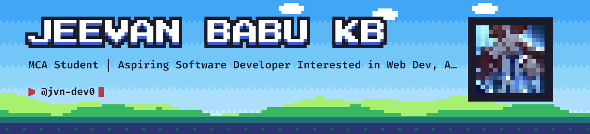

<!--
  ======================================================================
  JEEVAN BABU (@jvn-dev0) — OFFICIAL GITHUB PROFILE README
  Design Direction: Custom Pixel-Art Banner, Aesthetic Pink Gradient Theme
  Palette: #EF93C4 (Rose Gold), #F8BBD0 (Blush Pink), #FF69B4 (Hot Pink)
  ======================================================================
-->

  <!-- ==================== RESPONSIVE LIGHT / DARK BANNER ==================== -->
  <picture>
    <source media="(prefers-color-scheme: dark)" srcset="art/header-dark.png">
    
  </picture>

  <!-- ==================== MAIN INTRODUCTION & ANIMATED TYPING SVG ==================== -->
  <h1>Hey there, I'm Jeevan Babu 👋</h1>

  

    

  <!-- ==================== PINK GITHUB BADGES ==================== -->
  

    
    
    
    
  

---

<!-- ==================== ABOUT ME SECTION ==================== -->

  <h2>🌸 About Me</h2>

<table width="100%" border="0" cellspacing="0" cellpadding="0">
  <tr>
    <!-- 65% Narrative Profile -->
    <td width="65%" valign="top">
      

        I am an <strong>MCA Student & Aspiring Software Developer</strong> passionate about architecting scalable full-stack web applications, applied AI/ML systems, and interactive 3D browser experiences. I combine clean, modular code with modern visual design to turn ideas into robust reality.
      

      <ul>
        <li>🏛️ <strong>Featured Project:</strong> Engineering <strong><a href="https://github.com/jvn-dev0/Aurevant_Auction_House">AUREVANT — Auction House</a></strong>, an international digital auction marketplace merging real-time Three.js WebGL 3D artifacts with museum-grade connoisseurship.</li>
        <li>👁️ <strong>AI & Assistive Tech:</strong> Developed <strong><a href="https://github.com/jvn-dev0/BlinkTalker">BlinkTalker</a></strong>, an AI-powered eye-blink communication system with gaze tracking and Morse-code translation.</li>
        <li>🚗 <strong>Applied Machine Learning:</strong> Built <strong><a href="https://github.com/jvn-dev0/driveaware-ai-fatigue-risk-prediction">DriveAware AI</a></strong>, a database-driven ML system predicting driver fatigue risk levels.</li>
        <li>🔬 <strong>Technical Interests:</strong> Full-Stack Development, Real-Time 3D WebGL (Three.js), Applied Machine Learning & Computer Vision, and Cloud Systems.</li>
        <li>📚 <strong>Currently Learning:</strong> Advanced Three.js shader pipelines, Next.js 14 App Router patterns, and automated agentic testing workflows.</li>
        <li>🎯 <strong>Core Objective:</strong> Delivering production-grade applications characterized by high performance, zero defects, and thoughtful craftsmanship.</li>
        <li>🤝 <strong>Collaboration:</strong> Open to collaborating on innovative open-source platforms, impactful web software, and AI-driven applications.</li>
      </ul>
    </td>
    <!-- 35% Visual Showcase -->
    <td width="35%" align="center" valign="middle">
      
        
      <strong>Jeevan Babu KB</strong> 
      <em>@jvn-dev0 &bull; Creative Builder</em>
    </td>
  </tr>
</table>

---

<!-- ==================== CENTERED TECH STACK (SKILL ICONS) ==================== -->

  <h2>🛠️ Tech Stack & Tooling</h2>

  
<strong>Programming Languages</strong>

  
    

  
<strong>Frontend Development & 3D WebGL</strong>

  
    

  
<strong>Backend Development, Databases & AI</strong>

  
    

  
<strong>Development Tools & DevOps</strong>

  

---

<!-- ==================== GITHUB ANALYTICS & ACTIVITY ==================== -->

  <h2>📊 GitHub Analytics & Activity</h2>

  <!-- Streak Stats in Pink Theme -->
  

    

  <!-- Activity Graph in Pink Theme -->
  

    

  <!-- Side-by-Side Stats & Top Languages -->
  <table border="0" cellspacing="0" cellpadding="0">
    <tr>
      <td valign="top" align="center">
        
      </td>
      <td valign="top" align="center">
        
      </td>
    </tr>
  </table>

---

<!-- ==================== CONTRIBUTION GRAPH SNAKE ==================== -->

  <h2>🐍 Contribution Graph Snake</h2>

  <!--
    ======================================================================
    GITHUB ACTION SETUP INSTRUCTIONS FOR CONTRIBUTION SNAKE:
    1. Ensure the workflow file exists in your profile repository at:
       .github/workflows/snake.yml
    2. Workflow uses Platane/snk/svg-only@v3 with custom pink palette:
       dark_color_dots=#2B1A24,#EF93C4,#FF69B4,#FF1493,#FF69B4
    3. In Repo Settings > Actions > General > Workflow permissions:
       Select "Read and write permissions" and check "Allow GitHub Actions to create PRs".
    4. Run manually from Actions > "Generate Contribution Snake" > "Run workflow".
       The workflow deploys the snake SVGs to the 'output' branch automatically.
    ======================================================================
  -->

  <picture>
    <source media="(prefers-color-scheme: dark)" srcset="https://raw.githubusercontent.com/jvn-dev0/jvn-dev0/output/github-contribution-grid-snake-dark.svg" />
    <source media="(prefers-color-scheme: light)" srcset="https://raw.githubusercontent.com/jvn-dev0/jvn-dev0/output/github-contribution-grid-snake.svg" />
    
  </picture>

   
  <em>Automated daily contribution snake generated every midnight UTC via GitHub Actions</em>

---

<!-- ==================== CONNECT WITH ME ==================== -->

  <h2>📬 Connect With Me</h2>

  
Feel free to reach out for collaborations, project discussions, or inquiries:

  

    
    
    
  

  

    
    
    
    
  

---

<!-- ==================== PINK CAPSULE RENDER FOOTER ==================== -->

  

  

    <em>Crafted with care, precision, and passion by <strong>Jeevan Babu KB</strong>.</em>
  

  

    <a href="#hey-there-im-jeevan-babu-">⬆ Back to Top</a>
  

